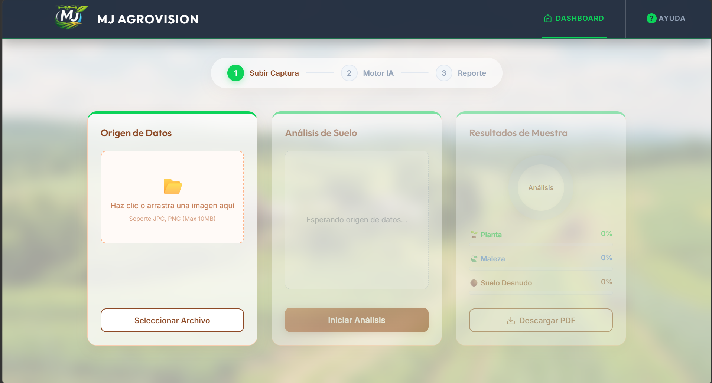

# MJ AgroVision

### Segmentación semántica y análisis de cultivos mediante Inteligencia Artificial | Proyecto TT

AgroVision es una plataforma web orientada a la agricultura de precisión que integra modelos de visión por computadora y aprendizaje profundo (*Deep Learning*) para el análisis visual automatizado de cultivos de frijol. 

A través de técnicas de **segmentación semántica**, el sistema clasifica cada píxel de una imagen para diferenciar y cuantificar con precisión la presencia de **cultivo de frijol**, **maleza invasora** y **suelo**, permitiendo calcular porcentajes de cobertura y generar reportes técnicos de diagnóstico.

---

## Funcionalidades principales

- **Segmentación semántica multiclase:** Clasificación a nivel de píxel en tres categorías clave:
  - 🟢 **Cultivo de frijol:** Detección y delimitación de la planta objetivo.
  - 🔵 **Maleza:** Identificación de maleza para evaluar competencia hídrica y nutricional.
  - 🟤 **Suelo:** Estimación de terreno expuesto.
- **Herramienta de recorte interactivo:** Selección y delimitación de regiones de interés (ROI) directamente en el navegador antes del análisis.
- **Ajuste fino de inferencia:** Configuración de umbrales de sensibilidad de maleza y contraste de suelo en tiempo real.
- **Cálculo de métricas de cobertura:** Estimación porcentual automática de cobertura foliar del cultivo vs. infestación de maleza.
- **Generación de reportes:** Exportación de imágenes segmentadas en formato PDF con métricas del análisis.

---

## Capturas de pantalla

### Interfaz de análisis


### Resultado de segmentación


---

## Stack tecnológico

| Área | Tecnologías |
|---|---|
| **Inteligencia Artificial** | PyTorch, `segmentation-models-pytorch` (smp) |
| **Arquitectura de red** | U-Net con encoder/backbone **ResNet-34** |
| **Procesamiento de imagen** | Albumentations, OpenCV (`cv2`), NumPy |
| **Backend & API** | Python 3.10+, FastAPI, Uvicorn |
| **Frontend** | React 19, Vite, JavaScript (ES6+) |
| **Herramientas de cliente** | `react-image-crop`, `jsPDF`, `html2canvas` |

---

## Arquitectura del sistema

```text
┌────────────────────────────────────────────────────────┐
│                   Usuario / Navegador                  │
└───────────────────────────┬────────────────────────────┘
                            │
                            │ 1. Carga de imagen y recorte ROI
                            ▼
┌────────────────────────────────────────────────────────┐
│                    Frontend (React 19)                 │
│              Previsualización y controles              │
└───────────────────────────┬────────────────────────────┘
                            │
                            │ 2. POST /api/analyze (Multipart/Form)
                            ▼
┌────────────────────────────────────────────────────────┐
│                   Backend (FastAPI)                    │
│        Preprocesamiento y normalización (Albumentations) │
└───────────────────────────┬────────────────────────────┘
                            │
                            │ 3. Tensor (512x512x3)
                            ▼
┌────────────────────────────────────────────────────────┐
│             Modelo Deep Learning (PyTorch)             │
│                 U-Net + ResNet-34                      │
│            Pesos entrenados: unet_frijol.pth           │
└───────────────────────────┬────────────────────────────┘
                            │
                            │ 4. Máscara de segmentación (3 clases)
                            ▼
┌────────────────────────────────────────────────────────┐
│                    Post-procesamiento                  │
│       Cálculo de porcentajes + Máscara a color BGR     │
└───────────────────────────┬────────────────────────────┘
                            │
                            │ 5. JSON + Máscara Base64
                            ▼
┌────────────────────────────────────────────────────────┐
│              Frontend: Visualización & PDF             │
└────────────────────────────────────────────────────────┘
```

---

## Endpoints de la API

La API REST documentada interactivamente en `http://localhost:8000/docs`:

| Método | Endpoint | Descripción |
|---|---|---|
| `POST` | `/api/preview` | Genera vista previa optimizada y escalada de la imagen subida. |
| `POST` | `/api/analyze` | Aplica recorte, ejecuta la inferencia con U-Net y retorna porcentajes de cobertura y máscara segmentada. |

---

## Estructura del repositorio

```text
Agrovision/
├── backend/
│   ├── main.py              # Servidor FastAPI y pipeline de inferencia
│   ├── unet_frijol.pth      # Pesos del modelo U-Net (ResNet-34)
│   └── requirements.txt     # Dependencias de Python
├── public/                  # Recursos gráficos y estáticos
├── src/                     # Código fuente de la interfaz React
│   ├── App.jsx              # Componente principal y flujo de análisis
│   └── main.jsx
├── index.html
├── package.json             # Dependencias del frontend
├── vite.config.js
└── README.md
```

---

## Instalación y ejecución

### Requisitos previos

- [Python](https://www.python.org/) 3.10 o superior
- [Node.js](https://nodejs.org/) 18 o superior

---

### 1. Configurar y ejecutar el Backend

1. Accede a la carpeta `backend`:
   ```bash
   cd backend
   ```

2. Crea y activa un entorno virtual de Python:
   ```bash
   # Windows
   python -m venv venv
   venv\Scripts\activate

   # Linux / macOS
   python3 -m venv venv
   source venv/bin/activate
   ```

3. Instala las dependencias:
   ```bash
   pip install -r requirements.txt
   ```

4. **Pesos del modelo:**  
   Asegúrate de que el archivo `unet_frijol.pth` se encuentre dentro de la carpeta `backend/`.

5. Inicia el servidor de FastAPI:
   ```bash
   uvicorn main:app --reload --host 0.0.0.0 --port 8000
   ```
   La API estará disponible en `http://localhost:8000` y la documentación interactiva en `http://localhost:8000/docs`.

---

### 2. Configurar y ejecutar el Frontend

En una nueva terminal, desde la raíz del proyecto:

1. Instala las dependencias de Node:
   ```bash
   npm install
   ```

2. Inicia el servidor de desarrollo:
   ```bash
   npm run dev
   ```

3. Abre el navegador en la URL indicada por Vite (usualmente `http://localhost:5173`).

---

## Contexto del proyecto

Proyecto desarrollado como **Trabajo Terminal (TT)** en la **Unidad Profesional Interdisciplinaria de Ingeniería Campus Zacatecas (UPIIZ - IPN)** para la carrera de Ingeniería en Sistemas Computacionales.

---

**MJ AgroVision** 
*Inteligencia artificial y visión por computadora para la agricultura de precisión.*
